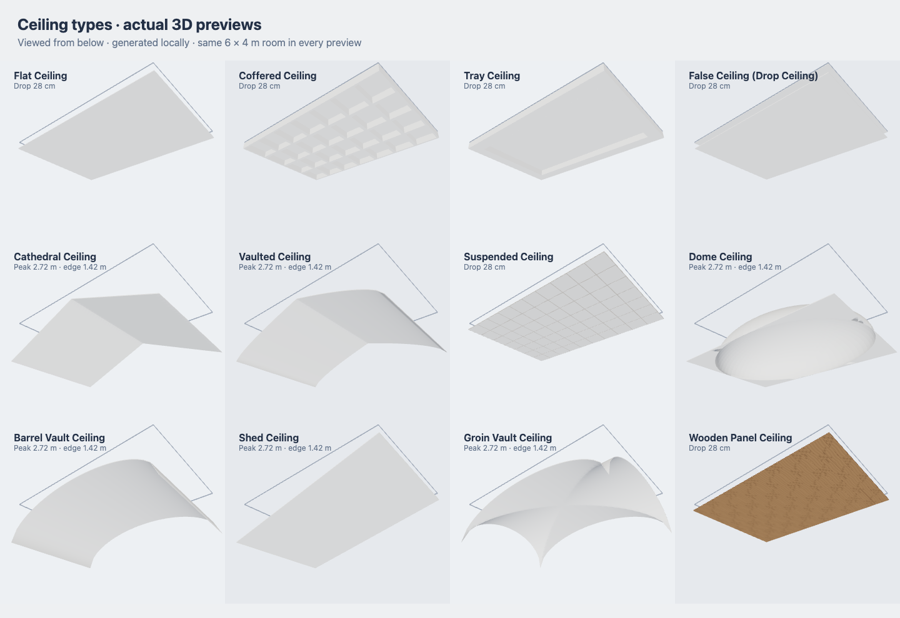

# All 12 ceiling types

The viewer includes all twelve ceiling types from the supplied image. Each generates local Three.js geometry. No paid model, API, texture download or new dependency is needed. The earlier 40 room finish concepts remain available.

To place light fixtures on these ceilings, see [ceiling lights and wall area marking](lights-and-wall-areas.md).



## Use in the viewer

1. Refresh the viewer, then open **Room Finishes**.
2. Select a room with a detected or traced inside boundary. Choose its style collection if the room is unclassified.
3. Open **Ceiling → Ceiling types** and choose a shape. **Material concepts** contains the earlier room-specific finishes.
4. Set the drop. Sloped and curved types also expose rise. Direction is available for directional slopes and wooden panels.
5. Choose **Apply to this room**. Choices are saved with the project in this browser and restored on reload. Reset removes only this room's finishes.
6. Close Room Finishes, enter **Walk**, and use **Toggle Ceiling**. Hold **T** to look up, **B** to look down, or drag with the right mouse button. Model and Render use the same geometry.

Ceilings start hidden for the overhead cutaway view. Hidden ceilings still participate in walking clearance, so hiding one does not allow a person through it.

| Ceiling type | Generated appearance |
| --- | --- |
| Flat Ceiling | Continuous level surface |
| Coffered Ceiling | Deep beam grid with higher recessed fields |
| Tray Ceiling | Lower perimeter surrounding a higher central field |
| False Ceiling (Drop Ceiling) | Secondary lowered plane with a narrow perimeter reveal |
| Cathedral Ceiling | Two straight slopes meeting at a central ridge |
| Vaulted Ceiling | Pointed curved vault, distinct from the straight cathedral slope and rounded barrel vault |
| Suspended Ceiling | Modular light panels separated by a visible support grid |
| Dome Ceiling | Rounded elliptical cap with a flat surround beyond its rim |
| Barrel Vault Ceiling | Rounded arch extended along the room |
| Shed Ceiling | Single straight slope from one side to the other |
| Groin Vault Ceiling | Two crossing barrel profiles with diagonal intersections |
| Wooden Panel Ceiling | Repeated boards with recessed joints and a locally generated grain texture |

The general term “vaulted” includes several architectural forms; this option uses a pointed curved variant so its preview differs from the separately listed barrel and groin vaults.

## Dimensions and headroom

Room points, wall lengths, original room height, floor area and printed measurement targets are unchanged by a ceiling choice. Settings use metres internally; the panel accepts centimetres.

For the six raised profiles:

```text
highest configured underside = room.height − ceilingDropM
lowest configured underside  = highest underside − ceilingRiseM
```

For example, a 3.00 m room with a 15 cm peak offset and 60 cm rise has a 2.85 m peak and 2.25 m low edge. The profile fits within the existing room height; it does not raise the walls. A larger rise lowers the edges. Combinations that would reach the floor are rejected without replacing the saved design.

For coffered, tray and false/drop ceilings, the dropped portion is at `room.height − ceilingDropM`, and the upper field is at `room.height − 0.035 m`. Other level types use the configured drop as their lowest finish height, with slightly recessed joints/grid details.

Profiles follow the actual room polygon, including concave outlines. Their shape is fitted to the polygon's bounding dimensions and then clipped to the room. An irregular room can therefore omit the nominal central peak. This is a visual fit, not an automatically designed roof structure.

Walk clearance uses the generated triangles at the person's position, including body radius and full standing height. A 175 cm person may pass below the high part of a slope and be blocked near a low edge. Eye height controls the viewing position independently. Base ceilings also follow individual room heights and footprints, avoiding a slab that bridges separate rooms or fills a concave void. Without usable rooms, the existing overall footprint remains a fallback.

## Saved data and implementation

```json
{
  "roomType": "living",
  "ceiling": "ceiling-cathedral",
  "ceilingDropM": 0.15,
  "ceilingRiseM": 0.6,
  "ceilingAxis": "x"
}
```

This object is stored in `room.design`. Axis `x` varies across plan X; `z` varies across plan Y, mapped to world Z. Settings can be retained when switching types. The catalog validates supported IDs and finite values before rebuilding.

- `ceilingTypes.js`: twelve definitions and bounded settings.
- `ceilingProfiles.js`: room-clipped geometry and configured underside heights.
- `roomDesignCatalog.js`, `roomDesignController.js`, `roomDesignPanel.js`: selection, validation, save/restore and controls.
- `generators/ceiling.js`: room-specific base slabs.
- `controls/walkCollision.js`: transformed triangle clipping for location-dependent clearance, with cached results and invalidation after geometry edits.

Drop is bounded to 5–45 cm and rise to 10–200 cm in this version. Ceiling type, rise and structural height are **not automatically inferred from a top-down floor plan**. Set these from a known ceiling/elevation specification. Models are visual concepts, not material quantity or construction specifications.

## Verification

Automated coverage checks all twelve distinct meshes, rectangular and concave boundaries, source measurement preservation, slope direction, ridge/edge heights, body clearance, hidden ceilings, separate base slabs, impossible settings, and saved selections after parsing/reload. Browser checks apply all twelve through the actual controls, reload saved settings, exercise room isolation and visibility, and switch between Model, Render and Walk.
