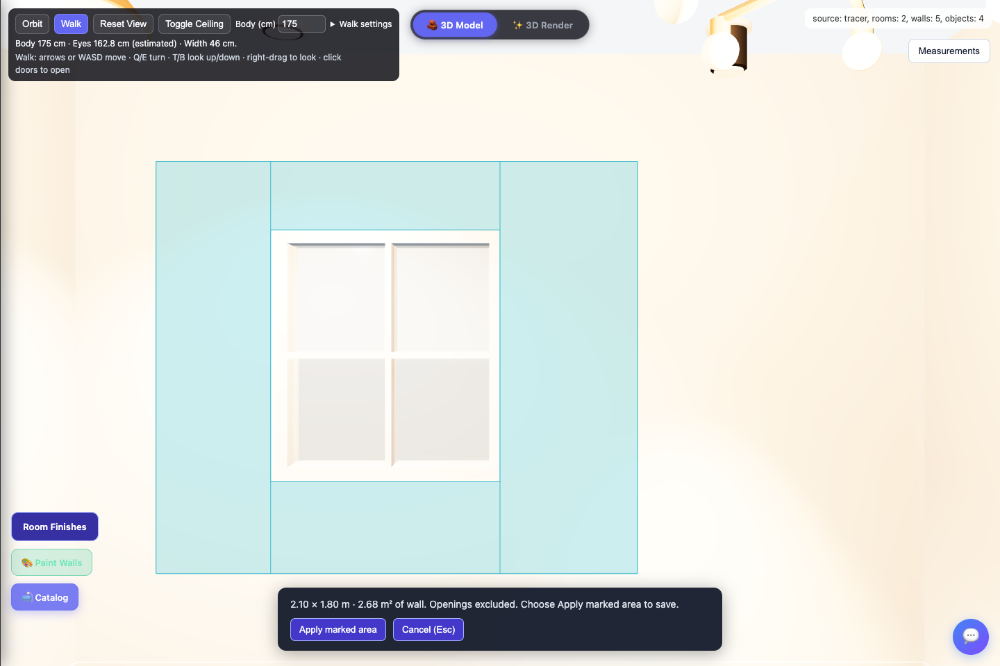
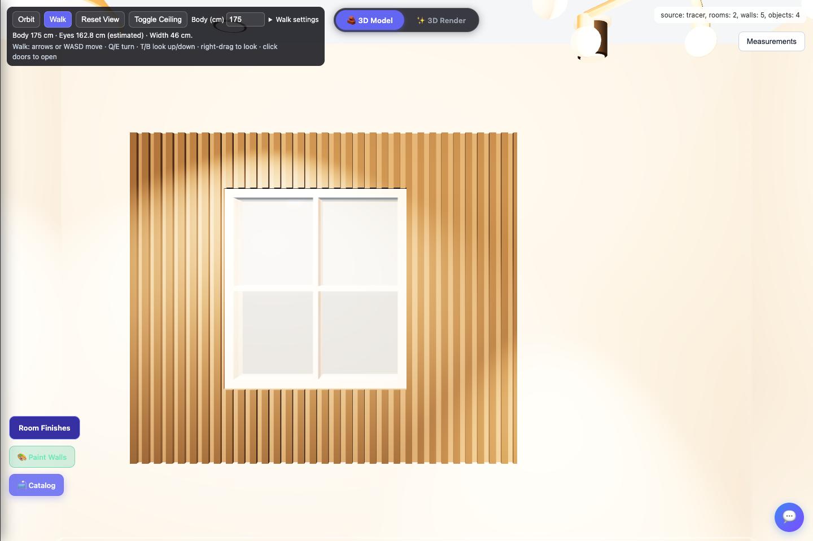

# Place ceiling lights and mark wall panel areas in 3D

**Room Finishes** now includes five ceiling light types and rectangular wall areas selected directly on the 3D model. Both features use local geometry and the existing project save: no paid assets, API, subscription or new dependency.

## Place and edit lights

1. Open **Room Finishes**, select a room with a valid inside boundary, and choose its style collection. Select the ceiling type/drop/rise you want, or retain the default ceiling.
2. Under **Ceiling lights**, choose **New light**, then its type, **Width (cm)**, **Depth (cm)**, brightness, colour temperature and rotation. Width runs left to right and depth front to back on the fixture before rotation; both accept 3–500 cm. Pendant and chandelier types also expose **Total hanging depth (cm)**, measured from the ceiling to the lowest part of the fixture. **Light on** controls illumination.
3. Choose **Place light in 3D**. This first saves the room settings so placement uses the selected ceiling. The ceiling temporarily becomes a blue translucent guide in the cutaway view.
4. Point at the blue ceiling to preview the fixture, then click to place and save it. Invalid positions display a message. Keep the entire fixture inside the room and clear of other fixtures.
5. To edit an existing fixture, **click that light in the 3D room** (Orbit or Walk), or use its individual **Edit** button under **Ceiling lights** in Room Finishes. The panel opens the owning room and selects that light. You can also choose it under **Light to edit**. **Edits update the 3D light immediately and save automatically**, including size, type, brightness, colour, rotation, hanging length and on/off. No Update button is needed. Blank or invalid entries keep the last valid light while you type; any placement or save error appears beside the controls. **Move light in 3D** lets you click a new ceiling position; **Delete selected light**, directly below the selector, deletes only that fixture. Resizing and deletion survive reload. Existing projects without size fields keep their original fixture sizes. Scene selection does not pass through visible walls or furniture.

**Cancel (Esc)** cancels the pending placement or move. Room settings saved at the start of light placement remain saved. Previous ceiling visibility is restored when placement finishes or is cancelled. Fixtures stay visible and illuminate the scene while the roof is hidden; their own on/off setting is independent of **Toggle Ceiling**.

### Move the fixture and shape its light on a wall

For a selected light, **Light position → Across room / Front-back (cm)** moves the fixture immediately. These are distances from the room outline's left/top bounding edges in the floor plan, not from the camera. Positions outside the room or overlapping another fixture retain the last valid placement and show a message. **Move light in 3D** remains available for click placement.

**Recessed downlight** and **Surface spotlight** also expose **Light spread and direction**. **Beam width / Beam height (cm at 1 m)** independently change the emitted beam, without resizing the fixture. Increase **Aim tilt** from 0° (straight down) to aim toward a wall, and use **Aim direction** to turn it around the fixture. Fixture rotation also rotates that aiming direction. The sizes are measured across the beam, perpendicular to its direction, one metre from the emitter; the actual wall patch also depends on the wall's distance, angle and intervening furniture. Width/height are a visual lighting approximation rather than exact measured wall coverage. All valid position, beam and aiming changes update live and survive reload.

Linear LEDs emit across their resized diffuser; pendants and chandeliers keep their broad light. Choose one of the two spotlight types for adjustable wall-directed beams.

| Choice | Saved type ID | Appearance |
| --- | --- | --- |
| Recessed downlight | `downlight` | Small round trim with a downward light |
| Surface spotlight | `surface-spot` | Ceiling-mounted cylindrical spot |
| Pendant light | `pendant` | Hanging cable and shade |
| Chandelier | `chandelier` | Hanging six-arm fixture |
| Linear LED | `linear-led` | Long rectangular housing and diffuser |

Lights attach to the actual ceiling underside, including slopes and recessed areas. Surface fixtures follow the local slope; pendants and chandeliers hang vertically. Placement uses metres internally, and fixtures are rebuilt against the current ceiling when the saved design changes. Hanging geometry participates in Walk clearance checks.

There are up to **16 lights per room**. Brightness accepts 50–5000 lumens, colour temperature 2200–6500 K, and hanging depth 10–150 cm. Downlights and surface spots cast shadows; the lighting is a visual approximation. This is not a certified illumination calculation, electrical installation plan or price quotation.

## Mark only the wall area you want

1. Open **Room Finishes**, choose the room and a **Wall paneling** style, then choose **Mark area in 3D**.
2. Click the first corner on an exposed **inside face** of a wall in that room. Click its diagonally opposite corner on the same wall. Use Walk or adjust the camera to reach the intended face; selection does not pass through furniture, glass or another wall.
3. Inspect the cyan preview and its width, height and actual covered wall area. Door and window openings are excluded, including when the rectangle spans them.
4. Choose **Apply marked area** to build and save the paneling. **Cancel (Esc)** discards the pending area.
5. Repeat for another area or wall. Select a different panel style before marking to give the new region its own style; previously saved regions retain theirs.

**Marked wall areas → Remove area** removes one saved region. Remove and mark again to change its boundaries. **Use full wall instead** explicitly replaces all marked regions with the selected whole-wall style; choose the accent wall when prompted. The TV backdrop and headboard cascade still use their accent-wall selection.

Marked areas cannot overlap and must contain real wall surface. Up to **32 regions per room** are supported. A marked rectangle controls its exact height, including for a style that normally uses a preset wainscot height. The mark describes coverage along the wall face; panel layers have their own visible depth extending into the room.

## Marking preview and saved result

## Saved geometry and verification

Light entries are stored in `room.design.ceilingLights`, with metre-based `x`/`z` coordinates and settings. Panel entries are stored in `room.design.wallPanelRegions`, with the original `wallId`, distances `startM`/`endM` from that wall's original start, heights `bottomM`/`topM`, and `styleId`. A cut segment beside an opening is not used as the coordinate origin. Choices survive reload in the same saved browser project.

These features leave room outlines, wall lengths, room floor areas and dimension constraints unchanged. Panel previews continue to use the same opening cuts as the wall renderer. **Reset this room** clears its finishes, marked areas and lights together; it keeps the floor plan and furniture.

Verification covers all five fixture geometries, ceiling attachment and clearance, room-edge/overlap rejection, light save/edit/remove, marked regions on different walls, diagonal and reversed wall directions, exact selected bounds, open door/window holes, unchanged source measurements and save failure rollback. Use the live 3D preview to inspect the result in both Model and Render.

Related: [all 12 ceiling types](ceiling-types.md), [40 room finish concepts](room-finishes.md), and [model scale and Walk measurements](model-scale-and-walk.md).
