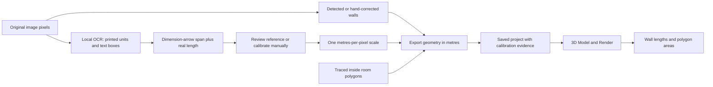

# Floor-plan measurements and code review

Updated 25 September 2026. These changes use local code and optional local Tesseract OCR. No paid service, asset purchase, model training, or API key is required for this workflow.

**Viewer update (2 October 2026):** [Verify model dimensions and walk at your own height](model-scale-and-walk.md) explains the current target/model comparisons, measured eye level, standing clearance and limitations.

**Workflow update:** [Automatic scanning and exact plan dimensions](exact-plan-dimensions.md) supersedes the comparison-only behavior described below. Upload now starts a local scan: clear printed lengths and areas are associated with actual wall spans and enclosed inside-room polygons, then jointly applied to the geometry. Manual measurement tools are fallbacks for unresolved readings. Use the new guide for current behavior, tolerances and supported geometry.

## What was wrong and what changed

| Finding | Change |
| --- | --- |
| The tracer guessed scale from a standard door width, or fitted the image to a 20 m span. Printed dimensions were ignored. | Local OCR now returns printed lengths/areas with evidence. Dimension arrows provide pixel spans. Agreeing readings can suggest scale; the user can review the span and confirm it. Manual calibration accepts feet/inches and metric units. |
| The tracer always exported `rooms: []`. Room detection boxes cannot establish floor areas. | Trace Room records actual inside-boundary polygons, including concave rooms. The same image-to-metre transform applies to walls, openings, furniture footprints and room outlines. |
| The viewer extended every wall by at least 0.24 m; nearby endpoints could add more. Exterior/half-wall classifications multiplied explicit dimensions. | Rendering now preserves the supplied endpoints, height and thickness. Detected stroke thickness is converted from pixels when calibrated. |
| Window/door fill pieces used fixed host dimensions and overlapping openings could leave opaque wall pieces. | Opening cuts use the host wall's dimensions, handle diagonal walls and overlapping openings, and avoid cutting nearby parallel walls. Door render height and cut height use the same values. |
| Wall paint could disappear when openings rebuilt. | Paint is attached to the original wall and persisted, including the pieces above/below openings. Removing an opening rebuilds its wall. |
| Invalid wall coordinates silently became zero; `metersPerUnit` was not actually applied. | Invalid geometry is rejected. Explicit input units are converted once to metres. Metadata survives import and save. Missing project files now report errors instead of silently showing a demo room by default. |
| The local room fallback invented four named rooms by dividing the building's bounding rectangle. | It uses supplied valid room polygons and reports when none are available. Local furnishing suggestions must fit those polygons and avoid overlapping other suggestions. |
| AI object records and scene IDs could differ; removal could affect unrelated saved objects. | Scene and saved project use the same IDs, selection/removal rules and persistence. Catalog/replacement rotations are saved. |
| Production builds omitted the tracer page and example layout JSON. | Both entry points, their imports and the fallback file are included in the Vite build. |

The review concentrated on application source, the detection API, geometry generation, persistence, schema and build configuration. It does not establish that every workflow is free of bugs or that wall detection is accurate on every drawing. Older review documents describe the state before these fixes.

## Use it with the attached plan

1. Restart the backend to load the measurement extractor, and reload the frontend. The existing development commands are `.venv311/bin/python apps/backend/src/train_server.py` and `npm run dev`. The backend listens on port 5050.
2. Upload the original plan in `tracer.html`, then run **Auto Detect**. Inspect and correct the wall overlay first.
3. Under **Plan measurements**, use **Review reference** to display an OCR dimension's orange span. Check both its printed text and endpoints, then choose **Use … for orange span**.
4. If OCR misses or misreads it, select **Calibrate Scale**, click the two arrow endpoints for the overall width and enter `41' 0"`. This is exactly **12.4968 m**. Do not select the edges of the uploaded image: white margins are not part of the building.
5. The printed vertical reference is `30' 10"`, or **9.398 m**. When detected, the panel compares this reference span against the model scale. If the references disagree, check the picked endpoints, OCR and image distortion. The application does not silently stretch one axis to hide conflicting dimensions.
6. Choose **Trace Room**, click its inside corners in order, then **Finish Room**. Enter its name and printed area if available, with units such as `120 sqft` or `11.15 m2`. The sample plan labels rooms but does not print individual room areas, so leave that field blank for this image.
7. Open **View in 3D**, then **Measurements**. Wall lengths appear in metres and feet/inches; room areas appear in square metres and square feet. Optional labels follow the model. **3D Model** and **3D Render** use the same geometry.

A printed room area is stored separately from the area calculated from its outline, so discrepancies remain visible. If no dimension reference is confirmed, **Scale whole plan from this room area** can set a uniform scale from the declared area and its traced polygon. It changes the scale of the entire plan. Once a linear reference is confirmed, a conflicting room area does not automatically deform walls; correct the boundary/reference instead.

The example's 41 ft × 30 ft 10 in dimensions describe its overall extents. Their product is **not** its actual floor area: the footprint has missing corners and a porch. Wall lengths shown are traced **centreline** lengths, while overall dimensions may reference outside faces. Room floor areas use the inside outline you trace. These are different measurements.

## How measurement evidence flows

The canonical export uses `units: "m"` and `metersPerUnit: 1`. `scale_m_per_px` describes the original image; it must not be applied again to exported geometry. Calibration is `confirmed`, `estimated`, or `unscaled`. The image name, reference endpoints, printed annotations and confidence remain in the saved JSON.

OCR uses the locally installed `tesseract` executable with horizontal and rotated text passes. Lengths require explicit units. Text alone cannot establish a pixel scale: the extractor looks for a thin dimension line with terminal marks. At least two reliable agreeing spans are required for an automatic suggestion. Conflicts above 3% block the suggestion. Missing OCR or a timeout leaves manual calibration available. Recognized thin dimension rules are excluded from automatic wall candidates; authored walls are preserved.

## Verification and limits

- Verification totals: **31 frontend tests and 43 backend tests passed**; backend sources compile and the production build succeeds. Vite still reports the viewer bundle-size warning described below.
- Frontend tests cover imperial/metric parsing, exact 41 ft conversion, room area scaling, save/import without double scaling, invalid geometry, explicit units, concave areas, opening cuts, wall dimensions and object persistence.
- Backend tests cover dimension parsing, arrow-line association, rotated text coordinates, conflicting references, area-only annotations, missing/timed-out OCR, dimension-rule removal, corrected walls, local room furnishing and invalid API JSON.
- Headless Chrome checks against both development and production builds exercised image upload, mocked detection, OCR-reference review, manual feet/inches entry, room tracing with a printed area, export, both 3D modes and reload, with no page errors. They used an isolated browser profile and synthetic geometry, not the user's saved project.
- An actual local Tesseract smoke check read `41' 0"`, matched the dimension arrows, and read `120 sq ft`. A tightly written `120 sqft` test was misread as `120 saft` and correctly left unassigned. Manual correction remains necessary for such cases.
- The original `test11.jpg` was not available as a workspace file. The attached screenshot's dimensions informed the regression cases; there has been no ground-truth accuracy evaluation of detection on that original image.

Wall detection and OCR remain fallible. Room labels are not segmented boundaries; open kitchen/living/dining areas need a boundary decision. Wall/ceiling heights, sill heights, furniture heights, materials and hidden construction details cannot generally be recovered from a top-down plan. The tracer exposes wall height/thickness defaults. Imported opening records can supply `height_m` and `sill_height_m`.

The viewer still uses a rectangular visual underfloor when an explicit `footprint.points` polygon is unavailable. It does not count that rectangle as floor area. The current furniture is procedural; dimensional consistency improves the experience but does not make it photographic or construction-certified. The existing optional cloud chat is separate from this free measurement workflow.

## Next improvements, without spending money

1. Add editable exterior footprint tracing and validated room segmentation, with clear separation of wall centrelines, inside faces and outside faces. Clip floor/ceiling geometry to the footprint.
2. Create a small manually annotated validation set from plans you can use. Track wall endpoint/length errors, missed walls, duplicate walls and room-area error separately; do not use a visually plausible rendering as proof of correctness.
3. Add reference constraints for individual walls and room dimensions, with a review screen for inconsistent dimensions. Keep user-confirmed geometry protected from later detection.
4. Add editable elevations for doors/windows and furniture, and enforce furniture clearance against existing objects and door swing paths. Current local furnishing only checks boundary containment and overlaps within its suggestions.
5. Split the large tracer/viewer files into project-state, measurement, selection and rendering modules after the behavior is covered by tests. The production build still reports a large viewer bundle; lazy-load the catalog/render effects when needed.
6. Follow [the zero-budget asset plan](zero-budget-3d-plan.md) for a small licensed GLB catalog. Accurate measurement, believable materials and good lighting should precede more AI features.
