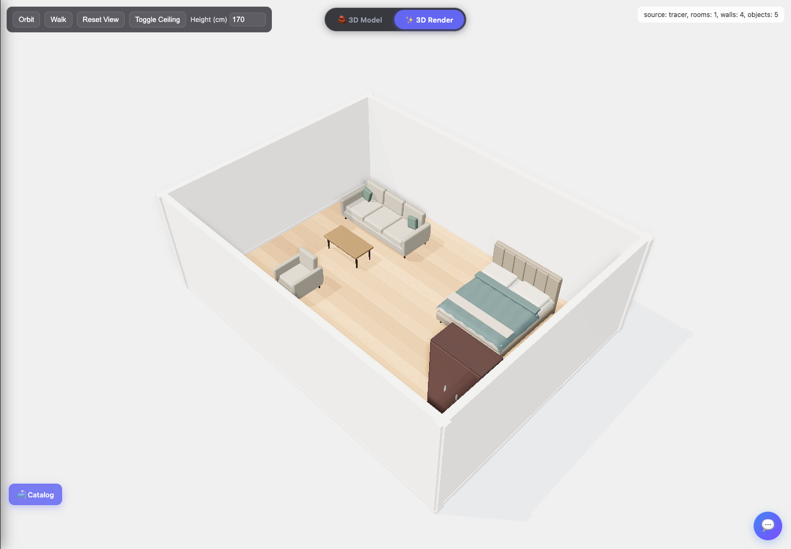

# Free rendering improvements

Implemented 20 September 2026. These changes improve the existing Three.js viewer without purchased assets, image generation, subscriptions, or model training.

## What changed

- Beds now have rounded mattresses, upholstered headboard panels, pillows, a draped duvet, and a folded blanket. Standard/single/double/queen/king beds use the detailed builder.
- Sofas, loveseats, L-sofas, armchairs and dining chairs have rounded individual cushions, shaped backs, legs, and distinct upholstery. Tables have softened edges and timber surface detail.
- Fabric and wood bump textures are generated deterministically in JavaScript. Each object owns its materials, while tiny texture resources are shared for the page lifetime.
- Render mode uses a locally generated lighting environment, daylight, and screen-space contact shading. It preserves the actual floors and furniture materials. The previous mirror floor, oversized replacement ceiling and hard-coded glowing downlights are removed.
- Render effects fit their lighting bounds to the actual plan. Postprocessing pixel ratio is capped at 1.5, with 16 ambient-occlusion samples. Model mode remains the cheaper rendering option.

## Bugs fixed

- Bed length was treated as furniture width, producing wide, shallow beds. Local width/depth now follow the object type and footprint.
- A nearby wall could rotate furniture without adjusting its dimensions. Wall proximity now chooses the facing direction while preserving the footprint axes.
- Catalog previews recreated every mesh and material on every mouse movement. A single preview is reused and disposed when canceled or replaced.
- Loading JSON discarded beds/sofas and silently capped objects. Accepted objects now survive import, including manual objects without a confidence score.
- Saved layouts were rescaled and door positions re-snapped. Only legacy raw detector output is normalized; saved scene coordinates and calibration metadata are retained.
- Saved furniture rotation was ignored during mesh generation. It is now honored; catalog placement, selection rotation, and deletion are saved to the existing local project slot.
- Render-mode cleanup now disposes postprocessing passes, environment targets, shadow targets, and the extra SSAO resources omitted by Three.js r160's disposal method. Original scene lighting/background are restored without rewriting shared materials.
- Lintels no longer create extra baseboards at floor level. Selection helpers are released on deselection, and door descendants are not duplicated in raycast targets.
- Camera startup/reset frames the plan instead of using one fixed distance. Camera keyboard shortcuts ignore text inputs and do not compete with selected-object rotation.

## Try it

```sh
npm install
npm run dev
```

Open the local address printed by Vite, load a traced plan, and select **3D Render**. Existing beds and sofas use the improved geometry automatically. The **Catalog** creates the same detailed objects. Select furniture to rotate or delete it; use **Reset View** to return to the plan overview.

For a production build:

```sh
npm run build
npm run preview
```

The new rendering features require no backend or cloud API. The project still contains its existing optional AI/backend features; this change does not disable those providers. Vite resolves the installed Three.js package locally. The HTML import map also preserves the old CDN-based static-server workflow, which still requires internet access; use the npm/Vite workflow for local dependencies.

## Verification

`npm test`: all 10 geometry/import/persistence regression tests pass. `npm run build` succeeds (Vite reports a bundle-size advisory). Chrome checks found no console errors or external requests during the rendering workflow, and three mode-switch cycles retained the same 70 geometries and 13 textures in the synthetic scene. Resizing and catalog opening also completed. A separate interaction check confirmed that mouse movement reuses the same preview object, clicking saves the placed chair, and Escape cancels placement without console errors. This is a resource-stability check, not a hardware FPS benchmark. Browser verification uses an isolated synthetic room fixture, not the user's private browser project. The preview below illustrates that fixture.



These are improved procedural objects, not photorealistic scanned products. Bunk/loft beds, appliances, and several specialized catalog items retain their existing generators. Exact product silhouettes, detailed upholstery seams and manufacturer-specific furniture require richer meshes. The next free step is the [local GLB catalog plan](zero-budget-3d-plan.md): prepare original models in Blender or use assets with redistribution rights. Blender is free to use, including commercially; Poly Haven publishes CC0 assets. Sources: [Blender license](https://www.blender.org/about/license/), [Poly Haven license](https://polyhaven.com/license).

The current room/door detection accuracy and guessed dimensions still limit the result. Calibrate one known length in the tracer before judging furniture scale. Local browser storage is a convenience rather than a backup; keep exported project JSON. Hardware frame-rate benchmarks and automatic training improvements are outside this rendering change.
