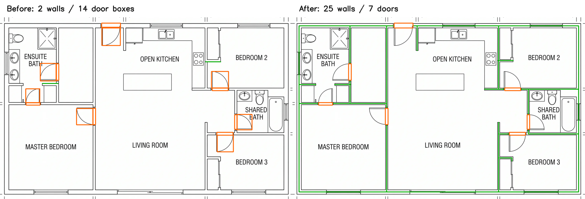
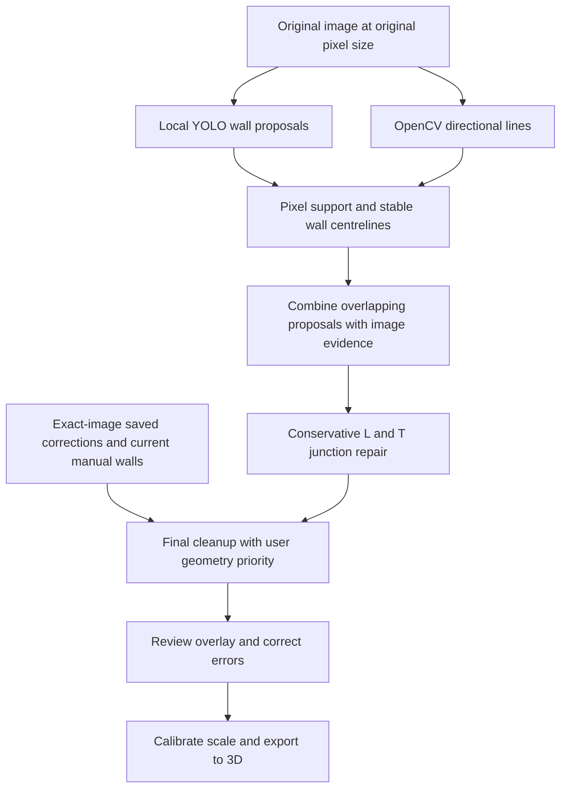
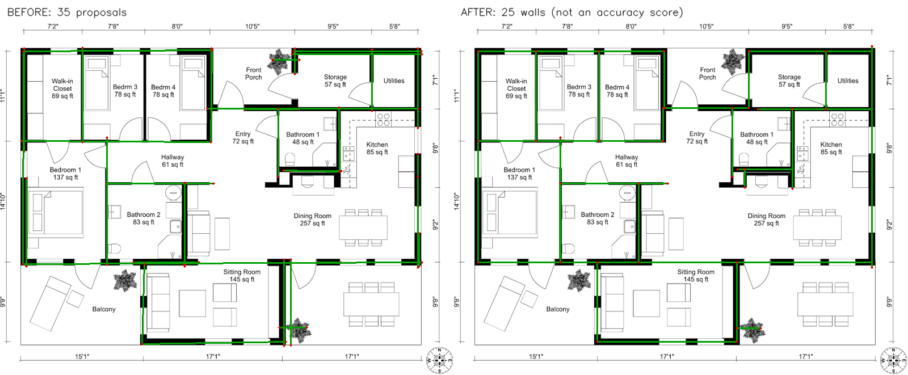

# Wall detection: fixes and a ₹0 improvement plan

The main duplication bug was in the pipeline: YOLO and OpenCV results were
cleaned separately, then concatenated. A single physical wall could therefore
appear twice. Increasing a distance threshold would hide some duplicates but
could also erase two real, closely spaced partitions.

These changes use the installed models, NumPy and OpenCV locally. No model was
downloaded, no training job was started, and no paid API was called for this work.

## September 26: outlined-wall regression on the uploaded plan

The original uploaded 2048 × 2048 plan was available locally. It uses thin,
parallel black faces with a white wall core. The solid-band morphological opening
removed these faces, and checking only the centre pixel rejected white-core YOLO
boxes. Increasing model confidence would not fix that representation mismatch.

The new [outlined_walls.py](../apps/backend/src/outlined_walls.py) pairs neighbouring
faces, learns recurring widths from long bands, checks the architectural network,
and retains short supported returns around openings. Recognized dimension rules
are excluded before pairing. Consolidation preserves the centre of the complete
band and its measured width, absorbs duplicate face detections, and checks both
faces instead of requiring dark centre pixels. Unsupported junctions, disconnected
furniture and end caps are filtered again after cleanup.

[door_geometry.py](../apps/backend/src/door_geometry.py) matches a narrow opening
box with the adjacent square showing the same door swing. It keeps opening
geometry and explicit swing metadata. Nearby distinct doors are no longer guessed
to be double doors; explicit double-door annotations remain. Manual corrections
take priority.

The actual local YOLO weights, OpenCV and Tesseract were run through the real API
handler with database writes, cloud services and training disabled:

| Original uploaded plan | Before | After |
| --- | ---: | ---: |
| Wall segments | 2 | 25 |
| Door boxes | 14 | 7 |
| Enclosed inside-face outlines | 0 | 6 |



These are diagnostic counts, not an accuracy percentage or a guarantee that every
architectural feature is correct. The thin cabinetry/door returns remain ambiguous;
Bedroom 3 is still connected to the living region in the extracted room topology.
Review that boundary before using its individual area. Angled/curved walls and
plans with unrelated detached structures need further work.

The printed dimensions in this particular source are also inconsistent: the bottom
4.50 + 5.50 + 3.50 m spans total 13.50 m, while the full width says 12.50 m. Some
top and bottom labels refer to different wall faces. The solver correctly flags
conflicting targets instead of claiming exact geometry. A rejected automatic
measurement now preserves recovered, unadjusted room outlines while removing
their automatic area targets. The scan summary shows geometry counts separately
from applied measurements.

New regression coverage includes hollow rooms, short returns, preserved door gaps,
detached furniture, dimension rules, duplicate faces, correction priority and door
fusion. A real local OCR → API → frontend solver test verifies that **both filled
and outlined** synthetic plans produce an actual 4.50 m span and 4.4 m² room when
the printed measurements are compatible. The complete suites contain 76 backend
and 59 frontend tests. All use local tools; no new service or paid dependency is
required.

A Chrome check uploaded this plan to the actual local tracer with the real local
handler's response replayed at the API boundary (to avoid database writes).
Two scans retained 25 walls, 7 doors and 6 outlines without accumulating duplicates
or browser errors. Conflicting measurements stayed flagged. The running backend
was restarted and its health response verified the new detection capabilities.

## Implemented

### October 2: missing wall above detected doors

The detector deliberately leaves a gap at a doorway. The viewer previously
generated lintels only by cutting openings out of a continuous wall, so a gap
between two detected wall segments stayed empty up to the ceiling.

The viewer now derives a temporary span between matching wall ends when a door
or window box supports that gap. The existing opening cutter leaves the wall
above it (and below a raised sill), using the host wall's height, thickness and
paint identity. These spans are only rendered: stored wall endpoints, measured
lengths and room areas stay unchanged. Nearby unrelated walls, unsupported gaps,
different wall sections and duplicate opening boxes do not create extra headers.

Re-running the actual uploaded plan produces one header for each of its seven
detected doors. Regression tests cover reversed/vertical walls, doorway clearance,
full-height openings, raised sills, corner-frame offsets, duplicate boxes and
nearby parallel walls. The frontend suite now has 69 passing tests; the production
build also passes. Existing saved layouts pick up the fix when the 3D viewer is
reloaded; rescanning and backend changes are not required.

A Chrome check using the actual plan geometry verified all seven headers from
both sides, clear doorways below them, both Model/Render modes, and wall-paint
persistence through a rebuild and reload. The check used an isolated browser
profile and did not modify the user's saved project.

| Problem | Change |
| --- | --- |
| Duplicate walls after combining detectors | Both proposal sets go through the same final centreline consolidation. |
| Both edges of a thick wall become separate walls | Sample perpendicular dark-pixel runs and locate a stable median centreline. Offset proposals merge only with supporting pixels between them. |
| Nearby real walls disappear | A white channel between parallel walls prevents the offset merge. Proximity alone is insufficient. |
| Dropping the shorter duplicate loses its unmatched extension | Merge overlapping projected intervals and retain both outer ends. |
| Large merge tolerances close openings | Cleanup never merges separated intervals; Hough gap bridging is capped at 2 px. |
| Centroid snapping tilts walls, collapses short segments, or chains distant corners | Use nearby line intersections for L/T junctions. Preserve the supporting direction and cap movement to 8 px and one quarter of each segment's length. Automatic snapping also checks image support. |
| Short wall returns are removed by a 5%-of-image cutoff | Keep shorter supported returns; reject small irregular CV fragments without a stable wall band. |
| Bounding-box centrelines run through blank pixels | Check support on the original thresholded image, after centring. |
| A specialized model may use class 0 for walls | Read class IDs from model names instead of assuming walls always have ID 1. |
| User corrections lose to fresh predictions | Authored geometry takes priority and stays fixed. Overlapping auto proposals retain only unmatched portions. |
| Similar-looking images inherit another plan's coordinates | Automatically reuse saved geometry only on an exact canonical image hash match. |
| Thin partitions are treated as half-height walls | Stop inferring wall height from drawing stroke thickness; retain explicit wall types. |
| Parameter tuning rewards duplicate predictions | Replace the recall-only score with one-to-one segment F1, including false positives and projected length overlap. |
| Repeated Auto Detect accumulates doors | Replace old automatic doors and preserve overlapping user-authored doors. |
| A late detection response overwrites newer edits | Prevent concurrent runs and discard stale responses after edits or an image change. |
| Manual door placement references an undefined variable | Use the click's actual canvas coordinates. |
| Corner cleanup cannot be undone | Snapshot edits, including scale, and restore them through Undo. |
| False walls cannot be removed directly | Add Delete Wall mode; click a line to remove it and Undo to restore it. |
| Labels show corrupted arrows/symbols | Declare UTF-8 in the tracer. |
| Saving/viewing corrections silently starts training on partial labels | Disable correction-triggered training by default. |

Image submissions now use PNG to preserve thin pixels and maintain consistent
image identity between detection and correction saving. The 20 MB server request
limit still applies. Wall confidence, provenance, type and measured pixel width
are retained through cleanup; exported height/thickness remain explicit scene
settings. Pixel width is **not** automatically treated as a reliable real-world
wall thickness.

## Current processing flow



The code is in [wall_geometry.py](../apps/backend/src/wall_geometry.py),
[wall_ai.py](../apps/backend/src/wall_ai.py),
[train_server.py](../apps/backend/src/train_server.py),
[tracer.html](../apps/frontend/tracer.html), and
[the browser geometry helper](../apps/frontend/src/tracer/wallGeometry.js).

## Verification and its limits

- 19 Python regression/integration tests cover overlaps, thick-wall edges, close
  separate partitions, doorway gaps, short returns, diagonals, L/T junctions,
  correction priority, metadata, detector fusion, class IDs, F1 scoring, and
  preventing similarity-based coordinate reuse/cloud review.
- 13 frontend tests pass, including the existing rendering tests and new wall
  snapping/repeated-door-detection tests.
- Chrome checks exercised the actual tracer: repeat detection, PNG submission,
  door placement, corner repair and undo, direct wall deletion and undo,
  concurrent requests, stale responses, and UTF-8. API responses were mocked to
  avoid database changes, training and external services.
- The production build includes both the viewer and tracer and passes, with
  the existing large-bundle advisory.
- Real inference ran against `apps/backend/sample_inputs/test.jpeg` with the
  existing `models/best.pt`. Before: 16 CV + 19 YOLO = 35 concatenated segments.
  After: 27 CV + 24 YOLO proposals consolidate into 25 final segments.
  This is a diagnostic comparison, **not an accuracy percentage**. The fixture
  is not the screenshot's source image and has no hand-verified ground truth.



The sample still contains an unwanted line near the lower plant and some
overextended endpoints. Some YOLO proposals already span door/window openings.
The new merger preserves gaps between separate proposals; it does not yet split
every model proposal at every opening. No claim of perfect wall detection is
justified by these checks.

Other current limits:

- Automatic detection targets horizontal/vertical filled and double-outline walls.
  Cleanup preserves manually supplied diagonals, but does not add a diagonal or
  curved-wall detector.
- Hatched, pale, heavily watermarked or low-resolution plans can still fail.
  Double-outline detection uses recurring widths, paired ink faces and network
  connectivity. Detached walls or very unusual thicknesses may remain missing.
- A dark furniture edge can still resemble a wall. Pixel support is evidence of
  a line, not proof of its architectural meaning.
- The exterior/interior convex-hull classification remains a heuristic,
  especially for concave building outlines.
- The manual Snap Corners action has geometry checks but no image mask. Review
  its result and use Undo if it joins a junction you did not intend.
- Delete Wall fixes the current editor/export. Deletion exclusions are not yet
  stored as persistent negative labels; running detection again may restore a
  deleted auto wall. Added/edited manual walls are preserved.
- Older saved corrections from JPEG-compressed submissions may need to be
  re-saved for the new PNG input's exact image hash.

## How to use the changes

1. Restart the backend process in its existing terminal. From the repository root,
   its command is `.venv311/bin/python apps/backend/src/train_server.py`.
2. Run `npm run dev` and open `http://localhost:5173/tracer.html`. Keep the normal
   frontend origin because the backend currently allows that origin explicitly.
3. Upload the original plan image. Prefer a clear scan or exported plan over a
   screenshot with colored detection overlays already drawn into it.
4. Run Auto Detect once. Hide room/object overlays with the existing Show checkbox
   while checking that each wall follows one centreline.
5. Use Delete Wall for false lines and Wall Mode for missing segments. Hold Shift
   for 0/45/90-degree drawing. Snap Corners is optional and undoable.
6. Check doorway gaps, windows, narrow partitions and short returns. Calibrate
   against a known dimension: estimated door widths are only a fallback.
7. Generate JSON or View in 3D after reviewing the overlay.

Zero-cost defaults for this detection/save workflow:

```dotenv
CLOUD_DETECTION_REVIEW_ENABLED=0
AUTO_TRAIN_ON_DETECT=0
AUTO_TRAIN_ON_CORRECTION=0
```

These defaults do not disable the separate AI chat feature or explicitly invoked
training endpoints. Keep cloud review disabled while working with a ₹0 budget.

## Next improvements, in order

### 1. Measure accuracy before changing models

Create a small reference set of roughly 20–30 plans you have permission to use,
including the kinds of plans you actually upload. Mark **all** walls, openings
and intended junctions in original pixel coordinates. Include thin partitions,
short returns, dark furniture, close parallel walls and poor scans.

Keep some plans exclusively for evaluation. Split by original plan/building,
not by random crops of the same drawing. Record precision, recall, duplicate
rate, centreline distance error, endpoint/junction error, and errors that bridge
openings. Report tolerances in pixels or calibrated units. The implemented F1
tuning helper is a starting point, not a replacement for these measurements.

### 2. Add opening-aware geometry and editable review

Project validated door/window intervals onto their host walls; store openings
separately and split geometry consistently for the 2D overlay and 3D builder.
Add drag handles for endpoints and persistent deletion exclusions. Use stable
wall IDs so corrections survive re-detection. Ensure the 3D viewer consumes this
geometry without its own arbitrary endpoint extensions. These are local code
changes and require no service subscription.

### 3. Use a wall mask for complex plans

My recommended next representation is a wall/background pixel mask followed by
centreline extraction, junction detection and a wall graph. It describes wall
shape more directly than an elongated bounding box. Keep the present detector
as a fallback and compare both on the reference set before replacing it.

For clean drawings, extend the existing OpenCV mask pipeline first. Its
directional morphology is suitable for extracting horizontal/vertical structures;
the official [OpenCV line-extraction tutorial](https://docs.opencv.org/4.12.0/dd/dd7/tutorial_morph_lines_detection.html)
explains this operation. For varied styles, evaluate a locally trained segmentation
model once mask/polygon labels exist. Ultralytics segmentation exposes pixel masks
and polygons, whereas your current detection weights provide bounding boxes;
see the official [segmentation task](https://docs.ultralytics.com/tasks/segment)
and [annotation format](https://docs.ultralytics.com/datasets/segment).

This is an architectural recommendation, not evidence that a new model will
outperform the current one. Ordinary pretrained object masks do not automatically
become a trained floor-plan wall detector. Use existing hardware and small local
experiments; training time may be substantial. Do not depend on paid GPUs or
assume a hosted free GPU will always be available.

### 4. Train only after complete review

Do not treat a few added wall segments as a fully labeled image: every other wall
would become an unlabeled positive. Export complete reviewed labels, keep a
validation split, record class names with the model, and promote new weights only
after measured improvement. Keep the current model available for rollback.

## Re-run the automated checks

```bash
.venv311/bin/python -m unittest discover -s apps/backend/tests -p 'test_wall_accuracy.py' -v
npm test
npm run build
```

The Python tests disable real database/cloud/training integrations and exercise
the handler with local synthetic images. Browser smoke checks in this session
used a temporary Playwright installation; it was not added as a project dependency.
