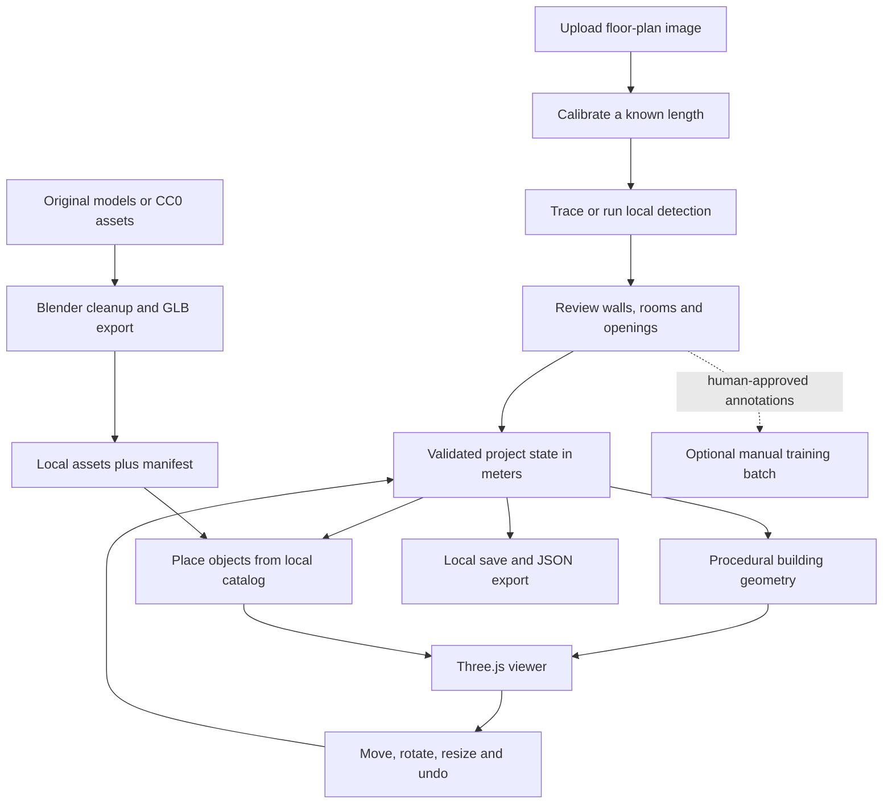

# Zero-budget 3D assets and project roadmap

Prepared: 19 September 2026. Related: [code review](code-review.md).

## Decision

Keep Three.js and the existing procedural building geometry. Add a small local GLB catalog, using Blender to prepare your own models and CC0 assets. Keep SketchUp as an optional authoring/import source. Build the first usable version around manual correction and placement; use local detection to assist it.

The core workflow should require no subscription, paid model API, hosted database, cloud GPU, or commercial asset pack. This assumes you use your existing computer and internet connection; storage, electricity, bandwidth, and your development time still have costs. A local application does not imply a free, always-on public backend.

## Where SketchUp fits

Yes, SketchUp can supply doors, lamps, cupboards, overhead storage, and other objects **after conversion into a supported asset format and verification of usage rights**. It supplies geometry; it does not solve floor-plan recognition, physical scale, placement, persistence, or wall openings.

SketchUp Free is restricted to noncommercial use. Its free web export options include STL, while richer interchange exports require subscriptions; the application-format table lists native glTF export under Pro/Studio. Do not plan on free native GLB export or a recurring trial. Sources: [SketchUp Free](https://help.sketchup.com/admin/sketchup-free), [web file management](https://help.sketchup.com/en/sketchup-web/file-management), [supported application formats](https://help.sketchup.com/en/sketchup/using-sketchup-data-other-modeling-programs-or-tools).

The official 3D Warehouse FAQ distinguishes using models inside combined design work from aggregating models into a website library, which it disallows. Therefore, do not copy a Warehouse collection into this app's public asset catalog. Use your own models or assets with explicit redistribution permission. A free download or conversion to GLB does not change that permission. Source: [3D Warehouse usage FAQ](https://help.sketchup.com/en/3d-warehouse/3d-warehouse-terms-use-faq).

### Optional SketchUp routes

| Situation | Route | Decision for this project |
| --- | --- | --- |
| Your own simple model, noncommercial use, SketchUp Free | Export STL → Blender → add/rebuild materials, verify dimensions → GLB. STL is a geometry-only route; it does not preserve the textured scene. | Possible, but more work than modeling directly in Blender. |
| A source supplies a permitted OBJ/FBX/GLB export | Import a format supported by the installed Blender version, normalize it, export GLB. | Useful if the redistribution rights cover the intended use. |
| You already have suitable paid SketchUp access | Export GLB if supported by that edition/version, or a supported interchange format → Blender cleanup. | Optional future convenience; do not buy it for this milestone. |
| Only a `.skp` file is available | Request an allowed interoperable export, or use the free STL route where its terms fit. | Do not assume Blender has built-in SKP support or add a paid conversion dependency. |
| A 3D Warehouse model is found | Check the creator's permission and whether the intended combined-work use is permitted. | Exclude from the shared catalog unless separate permission resolves aggregation/redistribution. |

## Better free options

| Option | Fit | Limits and role |
| --- | --- | --- |
| Existing procedural generators | Parametric walls, floors, openings, simple cupboards and overhead storage. | Lowest asset/download overhead; less decorative detail. Keep as fallback. |
| Blender | Original models, cleanup, scale/pivot correction, GLB export. | Requires learning time. Free software; artwork can be used commercially. [Blender licensing](https://www.blender.org/about/license/). |
| Kenney Furniture Kit | A consistent starter furniture collection. | CC0; best for a simple visual style. Verify the downloaded pack's formats and normalize chosen items. [Furniture Kit](https://kenney.nl/assets/furniture-kit). |
| Poly Haven | Selected realistic props and materials after the MVP. | CC0 assets; large source assets may need simplification. Use a few manually downloaded assets, not a runtime dependency on its service. [Asset license](https://polyhaven.com/license). |

Recommendation: use one visual style first. Start with original/procedural assets plus a few selected Kenney objects; add higher-detail assets only after measuring performance. An asset library need not share the detector's class list: a user can manually add a lamp even if no detector recognizes lamps.

## Proposed product flow and architecture



UI sketch:

```text
+------------------------------------------------------------------+
| Project name | Save | Undo | Redo | 2D / 3D | Export              |
+------------------+--------------------------+--------------------+
| Objects          |                          | Selected object    |
| [Search       ]  |  Plan / 3D canvas         | Cupboard           |
| Doors            |                          | Width / height     |
| Lamps            |  Select, move, rotate    | Depth / elevation  |
| Cupboards        |                          | Rotation           |
| Overhead storage |                          | Material           |
| Tables / seating |                          | Attach / delete    |
+------------------+--------------------------+--------------------+
| Scale: calibrated | Saved locally | Object load status            |
+------------------------------------------------------------------+
```

Treat "loft" initially as overhead storage, a common fitted-interior object. A habitable mezzanine is a later feature requiring floor levels, stairs, and separate room geometry; a decorative GLB alone does not provide those behaviors.

## Shared project data

Extend the existing plain JavaScript architecture with a project store. All UI actions update that store, and scene meshes are derived from it. Maintain backend detector coordinates separately from the canonical project.

Contract rules:

- Project coordinates: plan `{x, y}` maps to Three.js `{x, elevation, z: y}`. All accepted dimensions are meters, yaw is radians, elevation is measured from the project floor.
- Preserve source pixel dimensions, calibration method, pixel origin, and meters per pixel. Convert pixels once: `x=(px-originPx.x)*metersPerPixel`, `y=(py-originPx.y)*metersPerPixel`. Camera fitting never changes these values.
- Mark estimated scale explicitly. Let uncalibrated users preview, but request a known measurement before claiming physical dimensions.
- Give every entity a stable ID. Separate detector proposals and confidence from accepted objects; manually added objects need no detection confidence.
- Keep room polygons, walls, openings, and object instances distinct. A door opening exists independently of its decorative door mesh.

Illustrative target JSON below is a design example, not a format supported by the current application:

```json
{
  "schemaVersion": 1,
  "id": "project-demo",
  "units": "m",
  "source": {
    "imageId": "source-demo",
    "widthPx": 1000,
    "heightPx": 800,
    "originPx": { "x": 500, "y": 400 },
    "metersPerPixel": 0.01,
    "calibration": "manual"
  },
  "rooms": [],
  "walls": [
    {
      "id": "wall-1",
      "start": { "x": -3, "y": -2 },
      "end": { "x": 3, "y": -2 },
      "height": 3,
      "thickness": 0.15
    }
  ],
  "openings": [
    {
      "id": "opening-1",
      "kind": "door",
      "wallId": "wall-1",
      "offset": 2,
      "width": 0.9,
      "height": 2.1,
      "sill": 0,
      "hinge": "start",
      "swing": "positive"
    }
  ],
  "objects": [
    {
      "id": "object-1",
      "class": "cupboard",
      "assetId": "original.cupboard.01",
      "assetVersion": 1,
      "position": { "x": 1, "y": -1.6 },
      "elevation": 0,
      "yaw": 0,
      "dimensions": { "width": 1.2, "height": 2, "depth": 0.6 },
      "source": "manual"
    }
  ]
}
```

Define `offset` as distance from wall start to the opening's first edge along the wall. Validate `offset >= 0`, `offset + width <= wallLength`, and `sill + height <= wallHeight`; reject overlapping opening intervals. Derive swing relative to the directed wall. If a door model is used, add an object linked through `openingId` and derive its placement from that opening instead of maintaining two independent transforms.

## Asset catalog and loader

Proposed files:

```text
apps/shared/
  layout.schema.json           # eventual single canonical schema
  assets.schema.json           # manifest validation
apps/frontend/public/assets/
  catalog.json
  models/                     # small curated GLB files
  thumbnails/
  licenses/                   # source license/permission records
apps/frontend/src/assets/
  catalog.js                  # ID lookup and category aliases
  assetLoader.js              # GLTFLoader, cache, clone and ownership
apps/frontend/src/state/
  projectStore.js             # serializable state and revisions
  commands.js                 # undoable changes
apps/frontend/src/editor/
  assetPanel.js
  selection.js
  placement.js
```

`public/` assumes the planned frontend build setup in phase 1; the current plain static server does not map that directory automatically. Until then, use the existing frontend root as the static root.

Each catalog entry should contain stable `id` and `version`, label/category/aliases, local model/thumbnail paths, original dimensions, pivot convention, permitted resize mode, source URL/author, license identifier, license-file path, and a content hash. For doors, record hinge/leaf node names. For wall/ceiling props, record the attachment anchor. Use actual provenance for each file; do not infer a whole website's license from a single asset.

Keep `.glb` as the runtime format, with embedded geometry and textures where practical. Three.js supplies `GLTFLoader`, and Blender's exporter supports binary glTF. Sources: [Three.js GLTFLoader](https://threejs.org/docs/pages/GLTFLoader.html), [Blender glTF exporter](https://docs.blender.org/manual/en/3.4/addons/import_export/scene_gltf2.html). Current documentation can describe newer features than this repo's Three.js 0.160.0; use matching loader/addon versions and begin with core glTF features.

Integration points:

1. **`jsonLoader.js`:** replace filtering/resizing behavior with schema validation and legacy adapters; preserve asset and placement metadata.
2. **`object.js`:** keep `createObject()` as the procedural fallback. Add an object factory that creates a stable root immediately and asynchronously replaces its placeholder child with a loaded asset.
3. **`main.js`:** build a project scene root and render ID-based state changes. Track a project revision so a late model load cannot reappear after deletion or switching projects.
4. **`chatPanel.js`:** emit validated commands to the store instead of directly changing meshes. The same asset resolver serves manual and AI placement.
5. **`index.html` / package configuration:** initially pin the existing Three.js version; resolve addons from the same package. Bundle locally for operation without CDN access after installation.
6. **Backend:** store layout JSON/revisions; do not add a server-side SKP converter or an external asset API for the MVP.

Loader lifecycle: resolve approved asset ID → show procedural placeholder → load once per asset version → clone a static scene hierarchy per instance → normalize/apply instance transform → replace placeholder → retain shared resources until the last reference is released. Clone materials when per-object customization is needed. On load failure retain the placeholder and expose a retry. Add compression decoders only when measurements justify them, and serve those files locally too.

## Preparing and positioning objects

For each original or permitted asset: remove unrelated scene objects, verify dimensions against a reference cube, apply transforms, simplify hidden/high-detail geometry, check normals and UVs, use exportable PBR materials, choose a meaningful origin, then export a single GLB and inspect it in the actual viewer. Blender authoring axes and runtime axes differ; verify the exported Y-up result before recording dimensions.

| Object | First implementation | Placement and behavior |
| --- | --- | --- |
| Door | Keep procedural frame/hinge; later replace the leaf with an original GLB. | Attach to an opening. Preserve opening width/height, wall thickness, hinge pivot, and swing; never stretch a whole frame blindly. |
| Floor/table lamp | Original or CC0 GLB. | Floor/table contact anchor, natural proportions, editable elevation. Emissive material first; actual lights optional and limited. |
| Cupboard | Procedural dimensioned box/carcass or original GLB. | Base-center origin, back-to-wall snapping, editable width/height/depth. Prefer procedural resizing to distorting handles and doors. |
| Overhead storage | Procedural fitted storage with optional decorative front. | Wall attachment and explicit elevation; ensure top remains below ceiling and opening clearances remain visible. |
| Mezzanine loft | Later geometry feature. | A separate level/slab with stairs and headroom; not an ordinary furniture import. |

Static decorative assets should normally scale uniformly from known natural dimensions. Parametric fitted furniture can expose independent dimensions. Check oriented footprints inside room polygons and against walls/openings; offer placement feedback and manual override for ambiguous geometry. Start with move/rotate/numeric entry, then add snapping.

Initial asset targets, to be measured rather than presented as achieved: ten curated assets, preferably under 1 MB each, textures at most 1024 px, roughly 5,000–20,000 triangles per prop, and no extra shadow-casting light per lamp. Profile a 30-object scene on the current computer; target at least 30 FPS during interaction. Use observed frame time, draw calls, transfer size, and memory to adjust these budgets. Defer large HDRIs, photorealistic rendering, and massive catalogs.

## Storage, detection, and a strict zero-budget mode

Use local project JSON export/import immediately. Add IndexedDB for multiple projects and autosave; keep model binaries in static assets, not base64 inside localStorage. Store project format and catalog versions so updates can migrate older saves. A browser save is not a backup: expose a project download action.

Retain the existing local MySQL adapter if useful; it does not require paid hosting. For a simpler optional backend, add SQLite behind a repository interface. First establish JSON backup/import, then migrate deliberately; do not automatically discard or rewrite the existing database. Browser-only manual editing should work without either DB.

The following flags are **proposed configuration**, not controls implemented today:

```text
LOCAL_ONLY=true
ALLOW_CLOUD_AI=false
AUTO_TRAIN=false
ALLOW_MODEL_DOWNLOAD=false
```

Enforce these centrally across HTTP routes, assistant providers, and training hooks. Current `AUTO_TRAIN_ON_DETECT` alone is insufficient. In local-only mode, absent weights result in OpenCV/manual fallback, absent cloud credentials do not block the UI, and no provider is called. Build simple commands such as adding an object and choosing a material directly into the editor. Do not require a local language model on an unknown memory budget.

Use local YOLO only with known available weights and reviewed license compatibility. Ultralytics offers AGPL and enterprise licensing; a zero-budget project should follow the applicable open-source terms rather than assume proprietary deployment is free. Audit dataset/model redistribution separately from the asset catalog before release. Source: [Ultralytics licensing](https://www.ultralytics.com/license). No paid-license purchase is part of this plan.

## Phased implementation backlog

Effort estimates are rough focused developer-days for one person familiar with this code. They exclude learning Blender, data annotation, and model training time. Complete phases by their exit checks rather than a calendar promise.

| Phase | Work | Exit check | Estimate |
| --- | --- | --- | --- |
| 0: contain regressions | Address R1/R3/R12: preserve current model files, disable all automatic training/cloud paths, loopback API and request limits. | Save/view generates no training job or cloud call; model class-map mismatch cannot replace weights. | 1–2 days |
| 1: reproducible foundation | R13: package/lockfile, optional Python dependencies, local asset serving, documented startup, small synthetic fixtures. | Fresh setup loads a fixture without DB/API keys; no CDN is required after install/build. | 1–2 days |
| 2: trustworthy projects | R4–R6/R8–R10: schema/adapters, meters/transform fixes, ID-based store, undo, JSON round-trip, safe message rendering. | Same plan looks and measures the same via file and tracer; edits survive export/reload. | 3–5 days |
| 3: asset proof | Prepare one cupboard and one lamp; add catalog, GLTFLoader cache, fallback, and stable instance roots. | Both load at correct size/orientation; a missing GLB leaves usable geometry; no paid service is contacted. | 2–3 days |
| 4: usable placement | Asset panel, selection, numeric transforms, snapping, overhead elevation, persistent asset refs; expand to ten assets. | Add/move/rotate/delete/undo/reload works; assets have documented licenses; 30-object benchmark recorded. | 3–5 days |
| 5: openings and rooms | R7/R11: wall-linked openings, confirmed polygons, arbitrary wall direction, explicit source identity. | L-shaped floor aligns; doors fit and swing; distinct plans never inherit corrections automatically. | 3–5 days |
| 6: optional AI improvement | R2: approved annotations, fixed splits, one prediction per combined model, comparable metrics and controlled promotion. | Candidate improves agreed held-out metrics without regressions; rollback works. | 2–4 days plus data work |

Dependencies: phase 2 precedes durable asset placement; phase 3 proves the loader before expanding the catalog. Imported doors wait for the opening contract in phase 5. Manual editing and procedural doors remain available during this work. Phase 6 is unnecessary for demonstrating the core product.

### Regression checks to add during implementation

1. Import a calibrated 10 m wall through file and tracer paths; measure 10 m in both.
2. Round-trip a manual door with no confidence, a sofa, cupboard, and elevated storage object.
3. Verify an asymmetric room floor, walls, and ceiling align at marked coordinates.
4. Fit a 0.9 × 2.1 m door into its host opening, including a rotated wall and adjacent windows.
5. Delete/switch projects while a GLB is loading; ensure the stale result is ignored.
6. Place two copies of one asset, recolor one, remove it, and verify the other remains intact.
7. Export/reload after manual and assistant commands; compare canonical state, dimensions, and IDs.
8. Reject malformed geometry, unapproved asset paths, oversized uploads, and HTML-like chat input.
9. With network disabled after dependency/asset installation, trace, furnish, save, and reopen a project.
10. For training only: validate disjoint source-image splits, class-map compatibility, candidate comparison, and rollback.

## First deliverable

A local demo where you calibrate and trace one room, view it in 3D, place a cupboard and lamp, add overhead storage at a chosen elevation, and reopen the saved project with everything intact. That is the most useful low-cost proof before investing in more models, automatic furnishing, or retraining.

This document proposes the implementation; no subscriptions, asset downloads, model conversion, or application behavior changes were performed as part of writing it.
